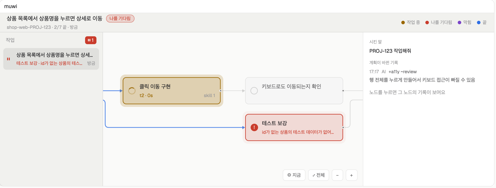

# muwi

> 무위(無爲): 인위적인 개입 없이, 자연스러운 흐름을 따른다.

AI에게 일을 맡기면 AI가 그 일의 진행 계획을 스스로 짜고, 그 진행을 그래프로 볼 수 있습니다. 순서를 미리 정해 줄 필요가 없습니다. 결과가 이상하면 어느 단계에서 왜 그랬는지 기록에서 찾을 수 있습니다.



muwi는 AI 도구와 [Herdr 앱](https://herdr.dev)에서 동작합니다. AI 도구(Claude Code, Codex, Gemini CLI, Cursor CLI, Copilot CLI, OpenCode 등)에 커넥터를 넣으면 AI가 자기 계획과 진행을 muwi에 적고, Herdr 앱이 그 기록을 그래프로 보여 줍니다. 어느 도구에서나 같은 방법으로 기록합니다. 리뷰는 Codex가, 구현은 Claude Code가 맡는 식으로 도구를 섞어도 작업 하나의 그래프 하나로 보입니다.

## muwi를 쓰면 좋은 점

- **AI가 지금 무엇을 하는지 보입니다.** 일을 맡기면 "요구사항 읽기 → 구현 → 리뷰" 같은 계획이 카드로 그려집니다. 진행에 따라 카드가 "작업 중", "끝"으로 바뀝니다.
- **내 결정이 필요한 순간을 놓치지 않습니다.** AI가 물어볼 게 생기면 그 카드가 "응답 대기"로 바뀌고, 그 작업이 목록 맨 위로 올라옵니다. 끝났는데 아직 보지 않은 작업은 "새 결과"로 따로 모입니다.
- **순서를 정해 주지 않아도 됩니다.** AI가 작업마다 그 일에 맞는 계획을 짭니다. 브랜치 규칙처럼 팀에서만 통하는 지식만 skill로 적어 두세요.
- **결과가 이상할 때 원인을 찾을 수 있습니다.** 노드마다 누가 했는지, 어떤 skill을 읽었는지, 몇 번 다시 했는지가 남습니다. "왜 그랬는지 봐줘"라고 하면 AI가 기록에서 원인을 찾습니다.
- **일이 여러 곳에서 진행돼도 한 그래프로 봅니다.** AI가 일부를 서브에이전트나 새 세션에 맡겨도 같은 그래프에 누가 하는지와 함께 표시됩니다.

### 순서를 정해 두지 않는 이유

모델이 좋아질수록 미리 정해 둔 순서는 도움이 아니라 한계가 됩니다. 그래서 muwi는 사람과 AI의 몫을 이렇게 나눕니다.

| 사람이 정하는 것 | AI가 정하는 것 |
| --- | --- |
| 팀에서만 통하는 지식 (skill로 적어 둠) | 어떤 노드로, 어떤 순서로 할지 |
| 넘으면 안 되는 선 (훅으로 지킴) | 어떤 skill을 읽을지 |
| | 직접 할지, 서브에이전트나 새 세션에 맡길지 |

muwi는 AI가 간 길을 기록하고 보여 줍니다. 순서를 강제하지 않고, 일하는 방식을 정해 주지도 않습니다.

### 순서를 강제하고 싶을 경우

AI에게 순서를 정해 줄 수 있습니다. 원하는 정도에 맞는 방법을 고르세요.

| 원하는 것 | 방법 |
| --- | --- |
| 이번 한 번만 이 순서로 | 시킬 때 순서를 같이 말하세요 |
| 이런 작업에는 이 단계가 꼭 들어가야 함 | skill에 "계획에 꼭 넣을 노드"를 적으세요 |
| 이런 작업은 항상 정확히 이 계획으로 | 계획을 JSON 파일로 만들어 두세요 |

muwi에는 AI가 순서에서 벗어나는 것을 막는 기능이 없습니다. 대신 AI가 순서를 바꾸면 누가 왜 바꿨는지 기록에 남습니다. 벗어났는지는 기록에서 확인하세요. 자세한 방법은 [정해 둔 순서로 진행시키기](docs/guides/fixed-workflow.md)에 있습니다.

## 설치하기

Node 24 이상과 npm이 필요하고, 그래프로 보려면 [Herdr 앱](https://herdr.dev)이 필요합니다. Windows에서는 Git for Windows도 필요합니다 ([Windows에서 쓰기](docs/reference/setup.md#windows에서-쓰기)).

muwi는 패키지 세 개로 나뉩니다. 모두 `muwi` 명령을 내므로 하나만 까세요. 위 패키지가 아래 패키지를 함께 데려옵니다.

| 패키지 | 들어 있는 것 |
| --- | --- |
| `@muwi/herdr-app` | `@muwi/herdr`의 모든 것에 더해 Herdr 앱의 작업 목록과 그래프 칸, 레이아웃 바꾸기 |
| `@muwi/herdr` | `@muwi/core`의 모든 것에 더해 Herdr 터미널에 새 세션 띄우기(`muwi run`), 세션이 살아 있는지 보기 |
| `@muwi/core` | 기록, 명령(`muwi plan`, `muwi show`, `muwi run`…), AI에게 주는 지침, AI 도구 커넥터. 멀티플렉서와 그래프 없이 기록만 쓸 때 |

1. 설치하세요.

   ```sh
   npm i -g @muwi/herdr-app
   ```

2. AI 도구에 커넥터를 넣으세요. 터미널용 `muwi` 명령과 Herdr 앱의 그래프 칸도 같이 들어갑니다.

   ```sh
   muwi setup --all            # 이 컴퓨터에 깔린 AI 도구 전부. 하나만이면 --tool <도구> (예: --tool codex)
   ```

   커넥터는 그 도구에 AI에게 주는 지침, 사용법 skill, 진행을 지켜보는 훅을 넣습니다. 넣을 수 있는 도구는 `muwi setup --tools`에 나옵니다. 이미 열려 있던 AI 세션은 새로 여세요.

3. Herdr 앱 화면에 muwi를 넣으세요. AI에게 "muwi 화면으로 바꿔줘"라고 해도 됩니다.

   ```sh
   muwi layout
   ```

   사이드바의 Agents 자리에 작업 목록이, 터미널 아래에 그래프가 생깁니다. 지금 레이아웃을 복제해서 바꾸므로 원래 화면은 그대로 남고, `muwi layout --remove`로 언제든 돌아갈 수 있습니다. 화면을 바꾸지 않고 보려면 `muwi open`으로 터미널 아래에 그래프 칸을 여세요.

처음이라면 [시작하기](docs/getting-started.md)를 따라 해 보세요. 설치되는 항목과 제거 방법, 도구마다 되는 것은 [설치와 설정](docs/reference/setup.md)에 있습니다.

## 사용하기

### 일 맡기기

평소처럼 말로 시키세요. 명령을 붙이지 않습니다.

```
PROJ-123 작업해줘
```

AI가 계획을 짜서 기록하고 일을 시작합니다. 계획을 짤지는 일의 크기로 정합니다. PR 리뷰나 조사처럼 파일을 고치지 않는 일도 여러 단계면 계획을 짜고, 질문에 답하거나 오타 하나를 고치는 것처럼 한 번에 끝나는 일에는 만들지 않습니다.

### 진행 보기

사이드바의 작업 목록에서 어떤 일이 내 응답을 기다리는지, 새로 끝난 일이 있는지 보고, 터미널 아래 그래프에서 그 일이 어디까지 왔는지 보세요.

작업 목록은 Herdr의 Agents 칸을 대신합니다. 작업을 급한 순서로 묶고(응답 대기 → 막힘 → 새 결과 → 작업 중 → …), 열려 있는 다른 대화도 같이 보여 줍니다. 작업을 누르면 그 작업의 그래프가 나오고, 그 작업을 한 대화가 아직 열려 있으면 끝난 작업이어도 그 대화로 갑니다. 다른 탭의 터미널로 옮겨 가면 그래프도 그 터미널의 작업으로 바뀝니다. 진행 중인 작업이 여럿이면 그래프 칸이 나눠 그리고, 못 들어간 작업은 맨 아래에 작은 지도로 깔립니다. 계속 보고 싶은 작업은 📌로 고정하세요 ([여러 작업 보기](docs/reference/graph.md#여러-작업-보기)).

그래프에서는 카드의 색과 표시로 진행을 확인하세요.

| 카드 | 뜻 |
| --- | --- |
| 작업 중 | AI가 그 노드를 하고 있습니다 |
| 응답 대기 | AI가 내 답이나 결정을 기다립니다. 무엇을 묻는지 카드에 나옵니다 |
| 막힘 | AI가 스스로 풀지 못했습니다 |
| 끝 | 끝났습니다. 결과 한 줄이 나옵니다 |
| `2회차` 표시 | 끝냈던 노드를 다시 하고 있습니다 |
| `서브`, `세션` 표시 | 서브에이전트나 새 세션이 하고 있습니다 |

카드를 누르면 그 노드의 기록이 나옵니다. 표시의 뜻은 [그래프 화면](docs/reference/graph.md)에 모두 있습니다. Herdr 앱이 없으면 `muwi status`와 `muwi show <작업>`으로 같은 내용을 글로 볼 수 있습니다.

### 계획 바꾸기

바꾸고 싶은 것을 말하세요.

```
화면 확인 전에 lint부터 돌려
```

AI가 계획을 고치고, 그래프가 다시 그려집니다. 누가 왜 바꿨는지도 남습니다. 자세한 방법은 [진행 중에 계획 바꾸기](docs/guides/change-plan.md)에 있습니다.

### 원인 찾기

결과가 기대와 다르면 이유를 물어보세요.

```
브랜치 이름이 틀렸네. 왜 그랬는지 봐줘
```

AI가 기록에서 원인을 찾습니다. 예를 들어 브랜치를 만든 노드에 브랜치 규칙 skill을 읽은 기록이 없으면, 그 skill 없이 일한 것입니다. 그러면 그 skill이 제때 읽히도록 skill의 설명을 고칩니다. 자세한 방법은 [결과가 이상할 때 원인 찾기](docs/guides/find-cause.md)에 있습니다.

## 알아 둘 점

- 그래프 보기는 Herdr 앱에서, 새 세션 띄우기는 Herdr 터미널에서 됩니다. 코어는 멀티플렉서를 모르므로, 다른 멀티플렉서도 터미널 연결을 만들어 붙일 수 있습니다 ([동작 원리](docs/how-it-works.md#터미널-연결과-보기)).
- 새 세션이 처음 보는 폴더에서 뜨면 폴더 신뢰 확인에서 멈춥니다. 그 칸에서 직접 확인을 눌러 주세요.
- 순서를 정해 둔 skill이 설치돼 있으면 AI가 계획을 스스로 짜지 않고 그 순서를 따릅니다. 함께 쓸 skill에는 판단 기준만 적으세요.
- 하던 작업을 끝내지 않고 다른 일을 시키면, 그 일의 기록이 하던 노드에 붙을 수 있습니다. "그건 새 작업으로 적어"라고 말해 주세요.

전체 목록은 [제한 사항](docs/reference/limits.md)에 있습니다.

## 문서

| 목적 | 문서 |
| --- | --- |
| 처음 써 보기 | [시작하기](docs/getting-started.md) |
| 할 일 찾기 | [결과가 이상할 때 원인 찾기](docs/guides/find-cause.md) · [진행 중에 계획 바꾸기](docs/guides/change-plan.md) · [하던 작업 이어 가기](docs/guides/continue-work.md) · [서브에이전트와 새 세션 다루기](docs/guides/delegation.md) · [정해 둔 순서로 진행시키기](docs/guides/fixed-workflow.md) · [문제 해결하기](docs/guides/troubleshooting.md) |
| 정확한 내용 확인하기 | [그래프 화면](docs/reference/graph.md) · [명령어](docs/reference/commands.md) · [설치와 설정](docs/reference/setup.md) · [기록 파일](docs/reference/records.md) · [제한 사항](docs/reference/limits.md) |
| 원리 이해하기 | [동작 원리](docs/how-it-works.md) |
| 코드 고치기 | [개발과 기여](CONTRIBUTING.md) |

## 라이선스

[MIT](LICENSE). `@muwi/core`가 그래프 배치에 쓰는 [elkjs](https://github.com/kieler/elkjs)는 의존 패키지로 받고, 라이선스는 EPL-2.0입니다.
