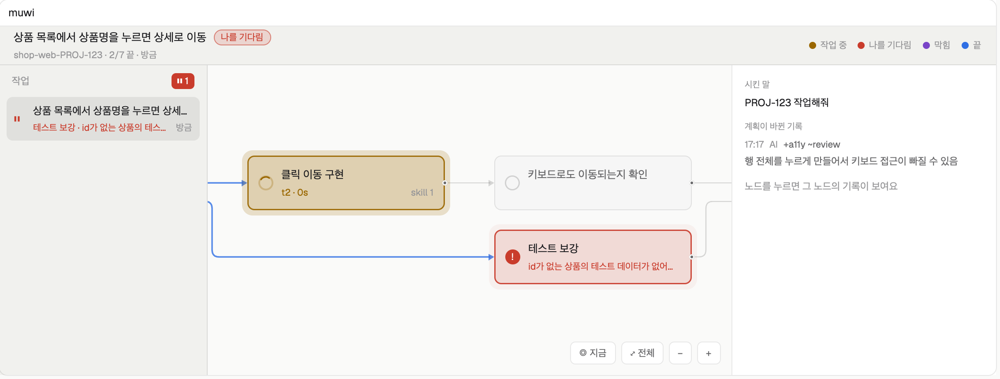

# 그래프 칸



Herdr 앱의 터미널에서 실행합니다. `muwi setup`을 한 번 해 둬야 합니다 ([설치](install.md)).

```sh
muwi open            # 이 터미널 아래에 그래프 칸을 연다
muwi open --right    # 오른쪽에 연다
```

- 왼쪽은 작업 목록입니다. 나를 기다리는 작업이 맨 위에 옵니다.
- 가운데는 고른 작업의 그래프입니다. 끌어서 옮기고, cmd/ctrl+스크롤로 확대합니다. 지금 일어나는 곳(작업 중, 나를 기다림)이 보이게 따라갑니다.
- 카드를 누르면 오른쪽에 그 노드의 기록이 나옵니다: 맡은 세션, 걸린 시간, 회차, 읽은 skill, 문제 표시. 맡은 세션의 터미널로 바로 갈 수 있습니다.
- 카드를 고르지 않으면 작업의 기록이 나옵니다: 시킨 말, 계획이 바뀐 이유들.

| 카드 | 뜻 |
| --- | --- |
| 작업 중 | 맡은 세션과 걸린 시간. 기록은 작업 중인데 Herdr가 보기에 그 세션이 멈춰 있으면 "세션이 멈춤"이 붙습니다 |
| 나를 기다림 | 사람의 결정이 필요합니다. 무엇을 묻는지 한 줄이 보입니다 |
| 막힘 | AI가 스스로 풀지 못했습니다. 이유가 보입니다 |
| 끝 | 결과 한 줄. 다시 했으면 회차가 붙습니다 |

## 레이아웃에 붙여 두기

레이아웃을 복제한 뒤 블록 내용을 `{ "mod": "muwi" }`로 둡니다. `props.variant`는 `list`(작업 목록만), `graph`(그래프만), 없으면 전부입니다.

## Herdr 앱 없이

같은 내용을 글로 봅니다.

```sh
muwi status          # 작업 목록. 나를 기다리는 작업이 위
muwi show <작업>      # 작업 하나의 기록: 노드, 읽은 skill, 계획이 바뀐 이유, 문제 표시
```
