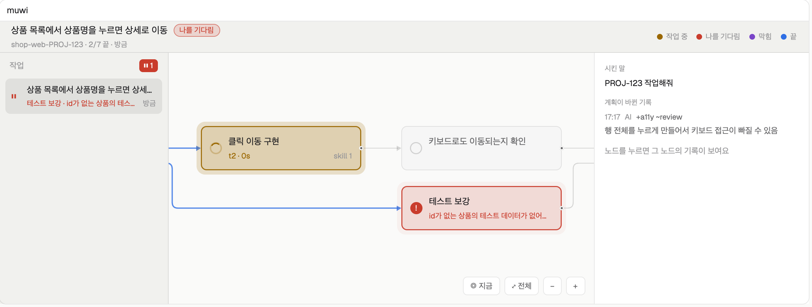

# 그래프 화면

Herdr 앱의 그래프 칸에 나오는 요소와 표시의 뜻을 정리했습니다.



그래프 칸은 `muwi open`으로 엽니다. 화면은 세 영역으로 나뉩니다.

| 영역 | 내용 |
| --- | --- |
| 왼쪽 | 작업 목록 |
| 가운데 | 고른 작업의 그래프 |
| 오른쪽 | 고른 노드의 기록. 노드를 고르지 않으면 작업의 기록 |

칸이 좁으면 작업 목록이 위쪽의 한 줄로 바뀝니다.

## 작업 목록

작업은 급한 순서로 나옵니다.

| 순서 | 상태 | 뜻 |
| --- | --- | --- |
| 1 | 나를 기다림 | 사용자의 결정이 필요한 노드가 있습니다 |
| 2 | 막힘 | AI가 풀지 못한 노드가 있습니다 |
| 3 | 작업 중 | 진행 중인 노드가 있습니다 |
| 4 | 멈춤 | 끝나지 않은 노드를 하던 세션이 모두 닫혔습니다 |
| 5 | 노드 사이 | 진행 중인 노드가 없고, 남은 노드가 있습니다 |
| 6 | 끝 | 모든 노드가 끝났습니다 |

끝났거나 멈춘 채로 7일 넘게 바뀐 것이 없는 작업은 맨 아래 "지난 작업 N개"에 접혀 있습니다. 누르면 펼쳐집니다. 기록은 지우지 않습니다.

## 그래프

노드는 카드로, 순서는 선으로 그립니다. 계획이 바뀌면 전체를 다시 배치합니다.

| 조작 | 방법 |
| --- | --- |
| 옮기기 | 빈 곳을 끌어서 옮깁니다 |
| 확대, 축소 | cmd 또는 ctrl을 누른 채 스크롤합니다. `+`, `−` 버튼도 있습니다 |
| 진행 중인 곳 보기 | `◎ 지금` 버튼 |
| 전체 보기 | `⤢ 전체` 버튼 |

그래프는 진행 중인 노드가 보이도록 따라갑니다.

### 카드의 상태

| 상태 | 카드에 나오는 것 |
| --- | --- |
| 아직 | 제목만 나옵니다 |
| 작업 중 | 걸린 시간. 그 세션이 멈춰 있으면 "세션이 멈춤", 확인을 기다리면 "세션이 입력을 기다림"이 붙습니다 |
| 나를 기다림 | AI가 묻는 내용 |
| 막힘 | 막힌 이유 |
| 끝 | 걸린 시간과 결과 한 줄 |
| 세션이 닫힘 | 끝나지 않은 노드를 하던 세션이 닫혔습니다. 카드가 흐려지고 시간이 멈춥니다 |

### 카드의 표시

카드 오른쪽 위에 몇 번째 하는지와 누가 하는지가 나옵니다.

| 표시 | 뜻 |
| --- | --- |
| `2회차` | 끝냈거나 막혔던 노드를 다시 하고 있습니다. 한 번에 끝난 노드에는 붙지 않습니다 |
| 없음 | 세션이 직접 합니다. 다른 세션이 이어받아도 직접 한 것으로 봅니다 |
| `서브` | 서브에이전트가 합니다. 여러 개면 `서브 ×3`처럼 나옵니다 |
| `+서브` | 세션이 직접 하고, 그동안 서브에이전트가 떠서 도왔습니다 |
| `세션` | `muwi run`으로 뜬 새 세션이 합니다 |
| 흐린 `서브`, 흐린 `세션` | 아직 시작 전이고, AI가 계획에 그렇게 적었습니다 |
| `≠계획` | 끝난 노드가 계획에 적은 방식과 다르게 진행됐습니다 |
| `skill 2` | 가장 최근 회차에서 읽은 skill의 수입니다 |
| ⚑ | 문제 표시가 있습니다 (`muwi flag`) |

## 노드의 기록

카드를 누르면 오른쪽에 나옵니다.

| 항목 | 내용 |
| --- | --- |
| 상태와 결과 | 상태, 그리고 결과 한 줄(또는 묻는 내용, 막힌 이유) |
| 시간 | 시작한 시각, 작업한 시간, 회차 |
| 누가 | 한 쪽과 그 세션의 상태. "터미널로 가기"를 누르면 그 세션으로 이동합니다. AI가 계획에 적은 방식도 나옵니다 |
| 읽은 skill | 아래 표를 보세요. 다시 한 노드는 "회차별 기록"으로 나뉩니다 |
| 맡긴 말 | 새 세션에 맡긴 노드일 때, `muwi run`에 준 말 |
| 문제 표시 | `muwi flag`로 남긴 메모 |

### 읽은 skill에 나오는 말

| 나오는 말 | 뜻 |
| --- | --- |
| skill 이름 | 그 회차를 하는 동안 읽었습니다. `×2`는 읽은 횟수입니다 |
| "파일을 직접 읽음" | Skill 도구가 아니라 `SKILL.md` 파일을 열어서 읽었습니다 |
| "서브에이전트가 읽음" | 서브에이전트만 읽었습니다. 맡긴 세션에는 내용이 남지 않습니다 |
| "확실하지 않음" | 읽을 때 노드 여러 개를 동시에 하고 있었습니다 |
| 이미 읽은 상태 | 그 세션이 앞에서 읽어서 내용을 알고 있습니다 |
| "하는 동안 읽은 skill이 없어요" | 훅이 지켜보고 있었고, 읽지 않았습니다 |
| "시작과 끝을 한꺼번에 적어서 하는 동안의 기록이 없어요" | AI가 일을 마친 뒤에 시작과 끝을 함께 기록했습니다 |
| "읽은 skill을 볼 수 없었어요" | 그 세션에서 훅이 실행되지 않았습니다. 읽었는지 알 수 없습니다 |

서브에이전트가 한 회차에는 "이미 읽은 상태"가 나오지 않습니다. 서브에이전트는 아무것도 읽지 않은 상태에서 시작하기 때문입니다.

## 작업의 기록

카드를 고르지 않으면 오른쪽에 나옵니다.

| 항목 | 내용 |
| --- | --- |
| 시킨 말 | 사용자가 처음 시킨 말 |
| 계획이 바뀐 기록 | 누가(사람 또는 AI), 어떤 노드를, 왜 바꿨는지 |
| 빠진 노드 | 계획에서 뺀 노드와 뺀 이유 |
| 노드 밖에서 읽은 skill | 어느 노드도 하고 있지 않을 때 읽은 skill |
| 문제 표시 | 노드를 지정하지 않고 남긴 메모 |

## 레이아웃에 고정하기

그래프 칸을 Herdr 레이아웃에 넣어 두려면 블록 내용을 `{ "mod": "muwi" }`로 설정하세요.

| `props` | 값 | 설명 |
| --- | --- | --- |
| `variant` | `list` | 작업 목록만 보여 줍니다 |
| `variant` | `graph` | 그래프와 기록만 보여 줍니다 |
| `variant` | 없음 | 모두 보여 줍니다 |
| `work` | 작업 이름 | 그 작업에 고정합니다 |

여러 칸을 띄우면 고른 작업이 칸끼리 공유됩니다.

## Herdr 앱 없이 보기

터미널에서 같은 내용을 글로 볼 수 있습니다.

```sh
muwi status          # 작업 목록
muwi show <작업>      # 작업 하나의 기록
```
