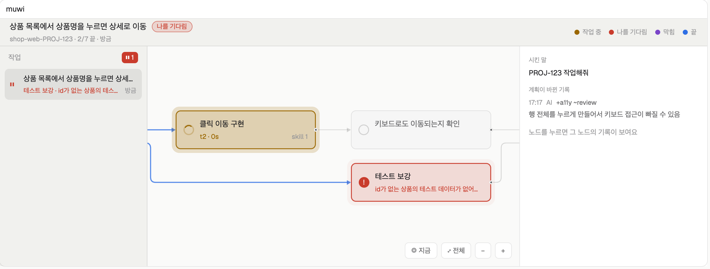

# 쓰는 법

일을 시킬 때는 명령을 붙이지 않고 그냥 말합니다. 여기서는 그 뒤에 사람이 하는 일을 다룹니다: 그래프로 보기, 도중에 고치기, 문제 찾기. 맨 아래에 명령 목록이 있습니다.

## 그래프로 보기



Herdr 앱의 터미널에서 실행합니다. `muwi setup`을 한 번 해 둬야 합니다 ([설치](install.md)).

```sh
muwi open            # 이 터미널 아래에 그래프 칸을 연다
muwi open --right    # 오른쪽에 연다
```

- 왼쪽은 작업 목록입니다. 나를 기다리는 작업이 맨 위에 옵니다.
- 가운데는 고른 작업의 그래프입니다. 끌어서 옮기고, cmd/ctrl+스크롤로 확대합니다. 지금 일어나는 곳(작업 중, 나를 기다림)이 보이게 따라갑니다.
- 카드를 누르면 오른쪽에 그 노드의 기록이 나옵니다: 맡은 세션, 걸린 시간, 회차, 읽은 skill, 문제 표시. 맡은 세션의 터미널로 바로 갈 수 있습니다.
- 카드를 고르지 않으면 작업의 기록이 나옵니다: 시킨 말, 계획이 바뀐 이유들.

| 카드 | 뜻 |
| --- | --- |
| 작업 중 | 맡은 세션과 걸린 시간. 기록은 작업 중인데 Herdr가 보기에 그 세션이 멈춰 있으면 "세션이 멈춤"이 붙습니다 |
| 나를 기다림 | 사람의 결정이 필요합니다. 무엇을 묻는지 한 줄이 보입니다 |
| 막힘 | AI가 스스로 풀지 못했습니다. 이유가 보입니다 |
| 끝 | 결과 한 줄. 다시 했으면 회차가 붙습니다 |

레이아웃에 붙여 두고 싶으면 레이아웃을 복제한 뒤 블록 내용을 `{ "mod": "muwi" }`로 둡니다. `props.variant`는 `list`(작업 목록만), `graph`(그래프만), 없으면 전부입니다.

Herdr 앱이 없으면 `muwi status`(작업 목록)와 `muwi show <작업>`(작업 하나의 기록)으로 같은 내용을 글로 봅니다.

## 도중에 플로우 고치기

말로 합니다. "화면 확인 전에 lint부터 돌려"라고 하면 AI가 계획을 고쳐 적습니다. 사람이 시킨 변경은 `사람`으로 표시되고 이유가 남습니다. 그래프에서 직접 노드를 고치는 기능은 없습니다.

## 문제를 찾아 고치기

```
나: 브랜치 이름이 틀렸네. 왜 그랬는지 봐줘
```

AI는 `muwi show`로 그 노드의 기록을 봅니다. 예를 들어 `[브랜치 준비]` 노드에 브랜치 규칙 skill을 읽은 기록이 없으면, 그 skill 없이 브랜치를 만든 것입니다. AI가 고칠 곳을 제안하고, 승인하면 그 skill이나 지침이 있는 저장소에 수정 PR을 만듭니다.

| 기록에서 보이는 것 | 고칠 곳 |
| --- | --- |
| 필요한 skill을 읽지 않았다 | 그 skill의 `description` |
| skill을 읽었는데 규칙을 잘못 적용했다 | 그 skill의 내용 |
| 계획 자체가 이상했다 | 지침 (`hooks/instructions.md`) |
| 하면 안 되는 일을 했다 | 훅 |

플로우는 매번 AI가 새로 짜므로, 고치는 대상은 플로우가 아니라 그 아래에 있는 지식과 지침입니다. 이렇게 고친 것은 모델이 바뀌어도 남습니다.

읽은 skill이 어떻게 기록되는지는 [원리](how-it-works.md#읽은-skill은-이렇게-기록됩니다)에 있습니다.

## 내가 정한 워크플로우대로 돌리고 싶을 때

"따르게 지시하고, 벗어나면 보이게" 할 수 있습니다. 벗어나는 걸 막는 기능은 없습니다.

| 원하는 정도 | 방법 |
| --- | --- |
| 이번 한 번만 이 순서로 | 시킬 때 순서를 같이 말합니다 |
| 이런 작업에는 이 단계가 꼭 들어가야 함 | skill에 "계획에 꼭 넣을 노드"를 적어 둡니다 |
| 이런 작업은 항상 정확히 이 플로우로 | 계획 틀을 JSON 파일로 두고 `muwi plan --file <경로>`로 시작하게 합니다 |

AI가 틀에서 벗어나면 "계획이 바뀐 기록"에 누가, 무엇을, 왜 바꿨는지 남습니다.

## 명령 목록

사람이 직접 쓰는 것은 보기와 설치 쪽입니다. 계획과 진행은 AI가 실행합니다. 사람이 직접 실행해도 똑같이 기록됩니다.

### 보기

| 명령 | 하는 일 |
| --- | --- |
| `muwi open [--right]` | Herdr 앱에서 그래프 칸을 이 터미널 아래(`--right`면 오른쪽)에 엽니다 |
| `muwi status [--json]` | 작업 목록. 나를 기다리는 작업이 위에 옵니다 |
| `muwi show [<작업>] [--json]` | 작업 하나의 기록: 노드, 읽은 skill, 계획이 바뀐 이유, 문제 표시 |
| `muwi session` | 이 세션이 붙어 있는 작업과 읽은 skill |

### 설치와 설정

| 명령 | 하는 일 |
| --- | --- |
| `muwi setup` | 터미널용 `muwi` 명령과 Herdr 앱 그래프 칸을 넣습니다 |
| `muwi setup --claude` | 플러그인 없이 쓸 때: Claude Code 훅과 사용법 skill도 넣습니다 |
| `muwi setup --codex` | Codex에 지침과 사용법 skill을 넣습니다 |
| `muwi setup --remove` | setup으로 넣은 것을 뺍니다 |
| `muwi config` | 지금 설정을 보여 줍니다 |
| `muwi config nudge on\|off` | 계획 없이 파일을 고치려 할 때 알릴지 (기본 on) |
| `muwi config guard on\|off` | `git push`, `gh pr`, Bitbucket PR 쓰기 앞에서 사람에게 물을지 (기본 off) |
| `muwi --version` | 버전 |

### 계획 (AI가 실행)

| 명령 | 하는 일 |
| --- | --- |
| `muwi plan --work <이름> --request "<시킨 말>" '<계획 JSON>'` | 새 작업의 계획을 적습니다 |
| `muwi plan --why "<바꾼 이유>" '<계획 JSON>'` | 계획을 통째로 바꿉니다. 같은 id의 노드는 상태를 잇습니다 |
| `muwi add <id> "<제목>" [--after a,b] [--before c] --why "…"` | 노드 하나를 끼워 넣습니다 |
| `muwi remove <id> --why "…"` | 노드 하나를 뺍니다 |

계획 JSON은 이런 모양입니다. 인자, `--file <경로>`, 표준 입력 중 하나로 줍니다. 사람이 바꾸라고 한 변경에는 `--human`을 붙입니다.

```json
{
  "title": "한 줄 설명",
  "nodes": [
    { "id": "read", "title": "티켓 읽기" },
    { "id": "impl", "title": "구현", "after": ["read"] }
  ]
}
```

### 진행 (AI가 실행)

| 명령 | 하는 일 |
| --- | --- |
| `muwi node <id> start` | 노드를 시작합니다 |
| `muwi node <id> done ["<결과 한 줄>"]` | 노드를 끝냅니다 |
| `muwi node <id> wait "<물어볼 것>"` | 사람의 결정을 기다립니다 |
| `muwi node <id> block "<이유>"` | 막혔습니다 |
| `muwi node <id> todo` | 아직 하지 않은 상태로 되돌립니다 |
| `muwi flag [<id>] "<메모>"` | 문제 지점을 표시합니다 |
| `muwi skip "<이유>"` | 이 세션은 계획 없이 진행합니다 (한 곳만 고치는 일, 기록할 작업이 아닐 때) |

`muwi board`와 `muwi hook`은 그래프 칸과 훅이 쓰는 내부 명령입니다.

### 작업 고르기와 환경 변수

작업은 `--work <이름>`이나 `$MUWI_WORK`로 고릅니다. 둘 다 없으면 이 세션이 붙어 있는 작업을, 그것도 없으면 이 폴더에서 시작한 끝나지 않은 작업을 씁니다.

| 환경 변수 | 뜻 |
| --- | --- |
| `MUWI_DIR` | 기록 폴더. 기본은 `~/.muwi` |
| `MUWI_WORK` | 다룰 작업 이름 |
| `MUWI_SESSION` | 세션 이름을 직접 정합니다. 기본은 Claude Code가 주는 세션 id |
